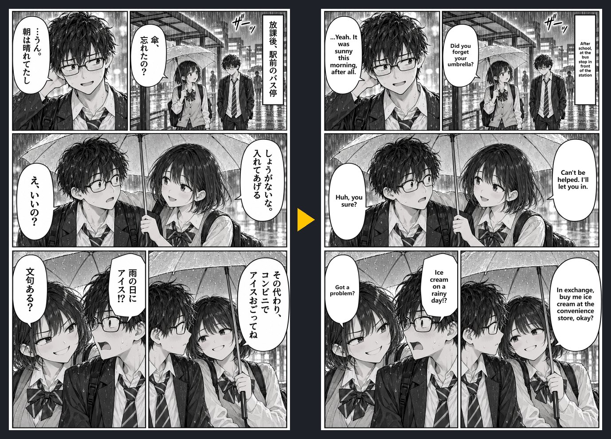

<h1 align="center">Manga Lens</h1>

Translate manga on any web page with <b>your own</b> DeepSeek or Gemini API key. 
About 4 seconds and a fraction of a cent for two pages. No server, no subscription.

<a href="README.zh-CN.md">简体中文</a>

Demo pages are original art made for this repo. Left: original. Right: Manga Lens, DeepSeek, about 4 s.

## What it does

Press **Alt+Shift+J** (or click the icon) while reading. Manga Lens:

1. takes a screenshot of what is on screen and finds the manga pages, including ones drawn on a `<canvas>`;
2. finds the speech bubbles and text **locally**, in your browser, and numbers them;
3. sends the page plus the numbered version to the model, which reads and translates each bubble;
4. wipes the original text and letters the translation back into the same bubble, with one font size per page.

Turn the page, scroll, or press the shortcut again to get the original back.

## Why

- **Cheap.** DeepSeek `deepseek-flash` costs about 3,000 tokens for two pages. Gemini Flash has a free tier.
- **Fast.** About 4 s for a two-page spread (thinking mode off).
- **Private.** Your key stays in your browser. Images go straight to the provider you choose, and nowhere else. See [PRIVACY.md](PRIVACY.md).
- **Works on most readers.** It works from a screenshot, so it doesn't care how the site draws its pages.

## Install

Not on the Chrome Web Store yet. Load it unpacked:

1. Download this repo (Code → Download ZIP) and unzip it.
2. Open `chrome://extensions`, turn on **Developer mode**.
3. Click **Load unpacked** and pick the `extension` folder.
4. Right-click the Manga Lens icon → **Options**, choose DeepSeek or Gemini, paste your key, press **Test**, then **Save**.

Get a key: [DeepSeek](https://platform.deepseek.com/api_keys) · [Gemini](https://aistudio.google.com/apikey)

Works in Chrome, Edge, Brave and other Chromium browsers.

## Tips

- Keep **thinking mode off**. It is 4–5× slower and rarely more accurate.
- Target language is set in Options (defaults to your browser language).
- Change the shortcut at `chrome://extensions/shortcuts`.

## Limits

- Vertical Japanese → horizontal text in the target language. Sound effects drawn into the art are left alone.
- Bubbles without a clear white inside (text over art, dark bubbles) are lettered on a small white label instead.
- Now and then a white face or object gets taken for a bubble.

## How it works

`render.js` finds white, closed regions with text-like dark marks inside (bubbles) and clusters of small dark marks (text blocks). The model gets two images: the clean page, and a copy with each bubble outlined and numbered. It answers with `{bubble, box, source, translation}` for each line. The extension checks each answer against the local detection (a box sitting on a different bubble gets moved there) and then letters the text. All of this is plain JavaScript with no build step.

## Please respect creators

This is a reading aid for manga you already have legal access to. Don't use it to redistribute translated pages. Support the official releases.

## License

[MIT](LICENSE)
