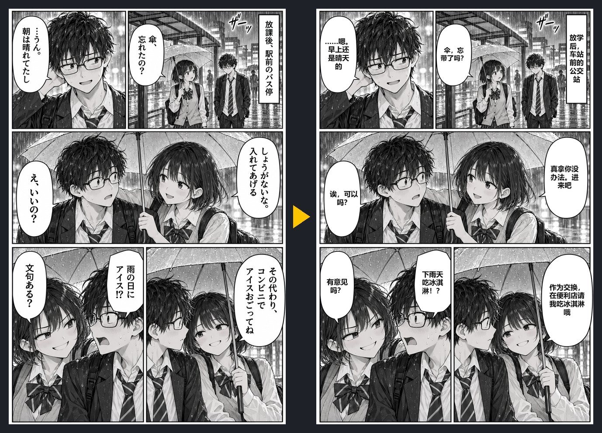

<h1 align="center">气泡翻译 Bubble Translate</h1>

用<b>你自己的</b> DeepSeek 或 Gemini API key 翻译任意网页上的漫画。 
两页约 4 秒，花费不到一分钱。没有服务器，不用订阅。

<a href="README.md">English</a>

演示页是为本仓库原创的图。左：原图；右：气泡翻译 + DeepSeek，约 4 秒。

## 它做什么

看漫画时按 **Alt+Shift+J**（或点插件图标），气泡翻译 会：

1. 截下当前画面，找到漫画页（包括画在 `<canvas>` 上的）；
2. 在你的浏览器里**本地**找出对话框和文字，并编号；
3. 把原图和编号图一起发给模型，模型逐框识别并翻译；
4. 抹掉原文，把译文排回同一个框里，同一页字号统一。

翻页、滚动或再按一次快捷键就还原。

## 为什么用它

- **便宜**：DeepSeek `deepseek-flash` 两页约 3000 token；Gemini Flash 有免费额度。
- **快**：两页约 4 秒（关掉思考模式）。
- **隐私**：key 只存在你的浏览器里，图片直接发给你选的模型商，不经过任何第三方。见 [PRIVACY.md](PRIVACY.md)。
- **大多数阅读器都能用**：它看的是截图，不管网站怎么画页面。

## 安装

还没上架 Chrome 商店，先用开发者模式加载：

1. 下载本仓库（Code → Download ZIP）并解压。
2. 打开 `chrome://extensions`，打开右上角**开发者模式**。
3. 点**加载已解压的扩展程序**，选 `extension` 文件夹。
4. 右键 气泡翻译 图标 → **选项**，选 DeepSeek 或 Gemini，粘贴 key，点**测试**，再点**保存**。

申请 key：[DeepSeek](https://platform.deepseek.com/api_keys) · [Gemini](https://aistudio.google.com/apikey)

Chrome、Edge、Brave 等 Chromium 浏览器都能用。

## 小提示

- **思考模式保持关闭**：开着慢 4–5 倍，准确度几乎不变。
- 目标语言在选项里改（默认跟浏览器语言）。
- 快捷键在 `chrome://extensions/shortcuts` 改。

## 已知限制

- 竖排日文 → 横排译文；画进画面里的拟声词不翻。
- 内部不是白底的框（字压在画上、黑底框）会改用小白标签。
- 偶尔会把白色的脸或物体当成对话框。

## 原理

`render.js` 找出白色封闭、里面有像文字的黑色笔画的区域（对话框），以及成团的小黑笔画（文字块）。模型收到两张图：原图，和每个框都描边编号的副本；它按行返回 `{框号, 位置, 原文, 译文}`。插件再拿本地检测结果核对（位置落在别的框上就挪过去），然后排字。全部是纯 JavaScript，不用构建。

## 请尊重作者

这是阅读辅助工具，只用于你本来就能合法阅读的漫画。请不要拿它传播翻译后的页面，支持正版。

## 许可证

[MIT](LICENSE)
